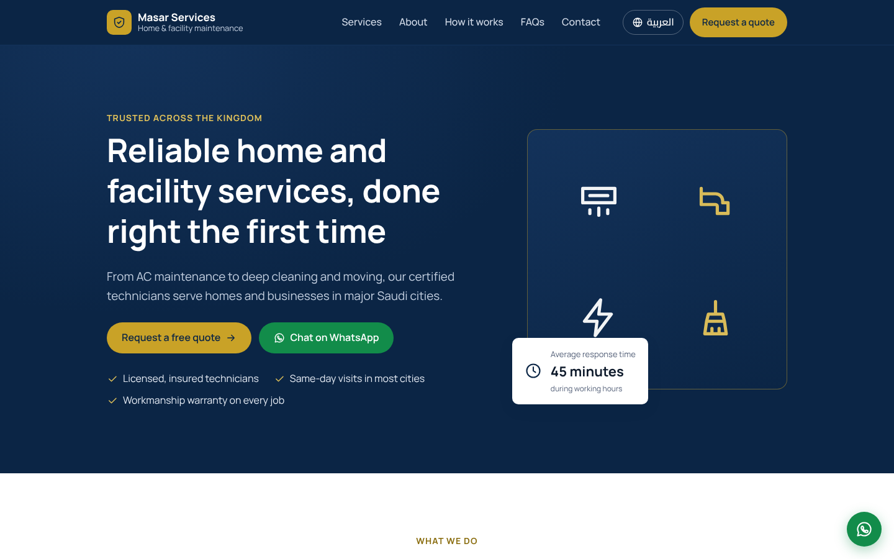
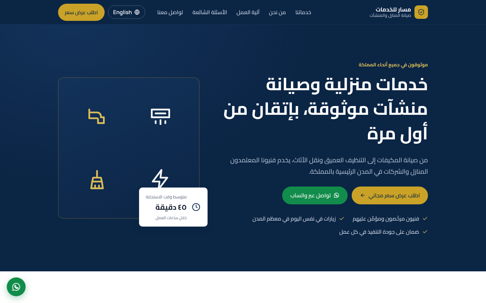
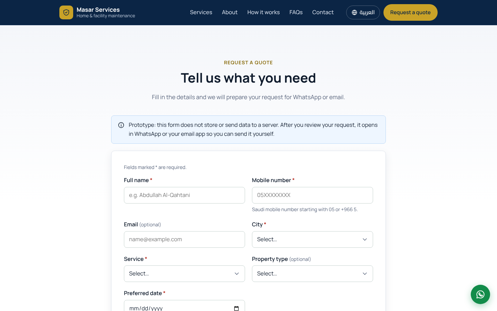
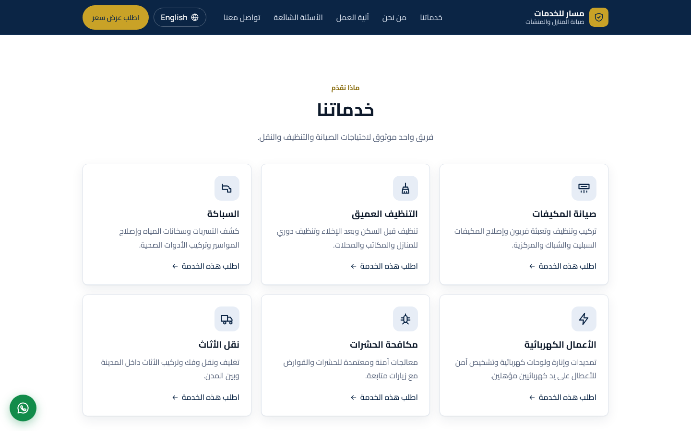
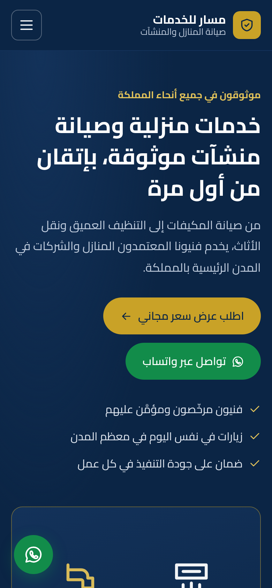
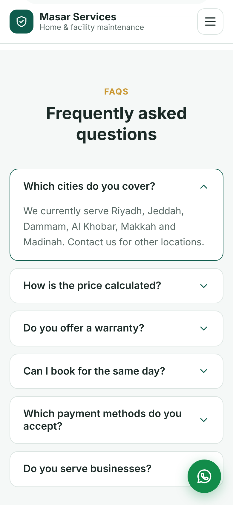
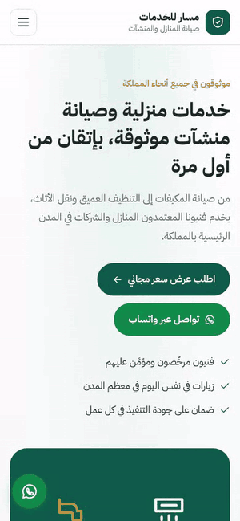
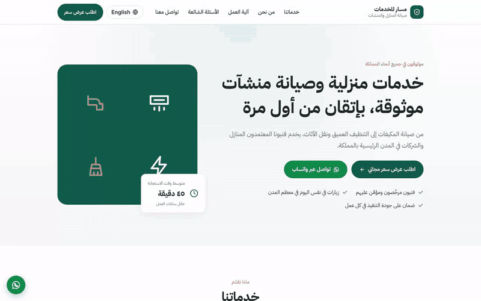

# Masar Services · Saudi Service Company Website

A bilingual (Arabic / English) marketing website for a Saudi home and facility services company. Visitors browse services, read FAQs, and send a quote request through WhatsApp or email.

Built with **React 19, TypeScript and Vite**.

<div dir="rtl">

موقع تعريفي لشركة خدمات منزلية وصيانة في السعودية، بالعربي والإنجليزي. الزائر يتصفح الخدمات ويقرأ الأسئلة الشائعة ويرسل طلب عرض سعر عبر واتساب أو البريد.

</div>

> **Portfolio demo.** "Masar Services" is a fictional company. Phone, WhatsApp and email are placeholders (see [Configuration](#configuration)).


## Screenshots

| English (LTR) | Arabic (RTL) |
| --- | --- |
|  |  |
|  |  |

**Mobile**

| Arabic | English | Menu and scrolling (Arabic) |
| --- | --- | --- |
|  |  |  |

**Quote request:** validation, then a review step before sending



## What's inside

- **Sections:** Hero, Services, About (stats and coverage), How it works, Request a Quote, FAQs, Contact.
- **Quote form:** Saudi mobile validation (also accepts Arabic-Indic digits), future-date check, error summary, then a review screen. The visitor sends it via **WhatsApp**, **email**, or copies it. Nothing is sent to a server, and the page says so.
- **Contact:** `tel:`, `mailto:` and `wa.me` links with a greeting in the current language, plus a floating WhatsApp button.
- **Bilingual layer:** typed `en` / `ar` dictionaries (a missing Arabic key fails the build), `<html lang dir>` updated on switch, choice saved in `localStorage`, no left-to-right flash on load.
- **RTL done properly:** CSS logical properties, mirrored arrows, phone numbers and emails kept LTR inside Arabic text.
- **No lost input:** switching language keeps typed values, and errors re-translate.
- **Accessible:** skip link, keyboard menu (Escape closes), accessible toasts, visible focus.

## Run it

Requires Node.js 20.19+ or 22.12+.

```bash
npm install
npm run dev        # http://localhost:5173
```

| Command | What it does |
| --- | --- |
| `npm run build` | Type-check and build to `dist/` |
| `npm run lint` | Lint with oxlint |
| `npm test` | Unit tests (Vitest) |
| `npm run test:e2e` | Playwright tests on desktop and mobile (run `npx playwright install chromium` once) |

## Configuration

| What | Where |
| --- | --- |
| Phone, WhatsApp, email, map, social links; `isDemo: false` hides the demo notices | `src/config/site.ts` |
| Company name, services, FAQs and all text, in both languages | `src/i18n/locales/en.ts` and `ar.ts` |
| Where the quote is sent (to plug in a form service or API later) | `src/components/QuoteForm.tsx` |

## Project structure

```
src/
  config/site.ts   business details (placeholders), service and city ids
  i18n/            dictionaries, language context, storage, Intl formatting
  components/      Header, Hero, Services, About, Process, QuoteForm, Faq, Contact, Footer
  lib/             validation, WhatsApp/mailto builders, quote message
  styles/          global.css
tests/e2e/         Playwright tests
```

## Deploy

The site is static (`dist/`), so any static host works.

- **Vercel / Netlify / Cloudflare Pages:** import the repository; build command `npm run build`, output `dist`.
- **GitHub Pages:** `.github/workflows/deploy-pages.yml` lints, tests, builds and deploys. It runs manually (Actions → Deploy to GitHub Pages → Run workflow) after you set **Settings → Pages → Source → GitHub Actions**.

No API keys or secrets are needed.

## License

MIT.
